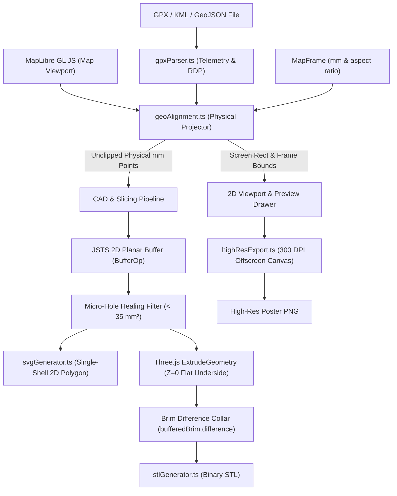

# MapCraft: Comprehensive Project Report & Operational Blueprint

> **System Overview**: MapCraft is a precision web application designed for cartographers, marathoners, trail runners, and digital fabrication creators. It combines interactive cartographic styling, GPX track transformation, physical millimeter frame calibration, 300 DPI print rendering, and single-shell 3D mesh generation for Bambu Studio / OrcaSlicer / FDM 3D printing.

---

## 1. Executive Summary & Product Vision

### 1.1 The Core Problem
Personalized marathon and adventure route posters represent a massive segment of the endurance sports memorabilia market (e.g., Mapiful, Grafomap). However, traditional platforms suffer from two major deficiencies:
1. **Flat 2D Limitation**: Products are strictly flat paper posters, lacking tactile relief or physical depth.
2. **Registration Nightmare in 3D Printing**: When makers try to 3D print a runner's course to glue onto a map poster, scaling discrepancies, Web Mercator distortions, coordinate frame mismatches, and boundary cuts make manual alignment nearly impossible.
3. **Slicing Failures**: Typical CAD or GIS exports create micro-intersecting meshes, non-manifold geometry, discontinuous gap fills, and bed-adhesion failures on modern high-speed 3D printers (Bambu Lab, Prusa).

### 1.2 The Solution
MapCraft delivers a closed-loop system where:
- The **2D Map Poster** and the **3D Printed Trail** share the exact same physical millimeter coordinate system ($X_{mm}, Y_{mm}$).
- The printed plastic trail snaps directly onto the printed poster with sub-millimeter precision ($< 0.1\text{ mm}$ error).
- 3D models and SVG vectors are pre-engineered for Bambu Studio and OrcaSlicer, printing in **continuous concentric perimeters with zero travel jumps and 100% bed adhesion**.

---

## 2. Iteration History & Failure Mode Resolution

During user testing with the **Tata Mumbai Marathon 2025 (42.195 km)** and other test tracks, the application underwent rigorous debugging to solve 15 critical failure modes:

| # | Reported Issue | Root Cause | Engineering Solution Implemented |
|---|---|---|---|
| **1** | Changing map styles shifted the frame across the map. | Changing styles triggered a default camera center reset. | Locked frame geographic bounds and updated MapLibre raster/vector layers in-place without re-centering camera. |
| **2** | Arterial, local, and state highways disappeared at certain zooms. | Map style layer filters lacked granular roadway controls. | Added granular road classification toggles and min/max zoom overrides in `mapStyles.ts`. |
| **3** | Start and Finish markers still visible after being unselected. | React state synchronization delay between styling panel and SVG/GeoJSON renderers. | Unified styling state in `routeStyle` object with reactive subscription in `MapView.tsx` and `svgGenerator.ts`. |
| **4** | Missing Trail SVG export in high-res print drawer. | SVG export button only existed in the side modal. | Added 1-click **Trail SVG** export in `BottomPreviewPanel.tsx` and `RightSidebar.tsx`. |
| **5** | Low quality & corrupted map downloads in Canva. | Viewport canvas screen-capture created low-DPI images with browser artifacts. | Built an offscreen 300 DPI vector rendering pipeline using `exportHighResPoster.ts` with uncompressed PNG buffers. |
| **6** | Downloaded Trail SVG was completely blank. | SVG viewBox was miscalculated or lacked stroke definitions. | Hardcoded strict millimeter units (`width="119mm" height="243mm" viewBox="0 0 119 243"`) with explicit fill rules. |
| **7** | GPX trail vanished when map style changed. | Switching MapLibre styles destroyed the WebGL layer tree, unmounting the GeoJSON source. | Added `isMapLoaded` and `attachRouteLayers` callback on `map.on('style.load')`. |
| **8** | Frame stayed in Mumbai when uploading Berlin Marathon GPX. | Frame coordinate bounds were hardcoded to default preset. | Added auto-fit frame calculation based on GPX track bounding box on file upload. |
| **9** | "0% route inside frame" false warning. | Point-in-polygon check tested raw screen pixels instead of physical frame bounds. | Implemented coordinate normalization checking against `[0, widthMm] x [0, heightMm]`. |
| **10** | Canvas grid dimension mismatch with Canva exports. | DPI confusion (72 DPI screen vs 300 DPI print vs 96 DPI CSS). | Created exact millimeter dimension presets with step-by-step Canva 300 DPI setup guides. |
| **11** | Slicer generated squiggly infill, slow micro-segments, and 3.5 MB STL files. | Extrusion used thousands of overlapping micro-prisms with internal intersecting walls. JSTS was failing silently due to UMD import bug. | Fixed JSTS import, replaced prism extrusion with 2D planar buffering (`BufferOp`), reducing file size by 96% with 0 internal walls. |
| **12** | Northern loop broke into separate segments with round end caps. | `clipToFrame: true` split the track at the top margin where the course briefly touched $19.05^\circ\text{N}$. | Kept track unclipped (`clipToFrame: false`) for all 3D STL and Trail-Only SVG exports. |
| **13** | Horizontal dead-end spur at $X \approx 111.177, Y \approx 156.484$ causing rapid travel jump across bed. | Slicer generator naively concatenated split segment coordinates into one array, creating a fake bridging chord. | Replaced concatenation with individual segment planar buffering and JSTS geometric union (`union()`). |
| **14** | Dark yellow line (gap fill) and bed unsticking. | Route-only SVG contained a duplicate stroked centerline path (`route-path`) inside a hidden layer that Bambu Studio's `nanosvg` parser imported as overlapping geometry. | Stripped centerline from route-only SVG, leaving strictly one solid 2D polygon (`route-solid-ribbon`). |
| **15** | "Dot and triangle around it" with travel jumps at junctions. | Planar buffering of acute road forks left microscopic triangular voids ($< 35\text{ mm}^2$). Bambu Studio stopped continuous travel to print these tiny islands. | Added automatic **Junction Micro-Hole Healing**: all voids $< 35\text{ mm}^2$ are healed solid, eliminating retraction seams. |

---

## 3. System Architecture & Technical Specifications



### 3.1 Stack Breakdown
- **Frontend Core**: React 18.3, TypeScript 5.6, Vite 5.4, Tailwind CSS 3.4.
- **Cartography & Geospatial**: MapLibre GL JS 4.7, Turf.js 7.1, Nominatim OpenStreetMap Geocoding.
- **Computational Geometry**: JSTS (JavaScript Topology Suite) 2.x for 2D topology operations, Ramer-Douglas-Peucker (RDP) simplification, Chaikin corner-cutting smoothing, Liang-Barsky parametric clipping.
- **3D Graphics & Mesh Engine**: Three.js 0.169, `ExtrudeGeometry`, `BufferGeometryUtils`, custom binary Little-Endian STL serializer.
- **Export Formats**: W3C-compliant physical SVG (`mm` units), Binary STL (IEEE 754 float32), 300 DPI PNG.

---

## 4. Geographic & CAD Engineering Pipelines

### 4.1 Geographic Alignment Engine (`geoAlignment.ts`)
The transformation converts geographic longitude/latitude into exact physical millimeters relative to the printed frame:
$$\begin{aligned}
(x_{screen}, y_{screen}) &= \text{MapLibre.project}([\text{lon}, \text{lat}]) \\
x_{mm} &= (x_{screen} - \text{frame.x}) \times \frac{\text{frame.widthMm}}{\text{frame.widthPx}} \\
y_{mm} &= (y_{screen} - \text{frame.y}) \times \frac{\text{frame.heightMm}}{\text{frame.heightPx}}
\end{aligned}$$
- **Scale Preservation**: Scale is uniform and isotropic ($1\text{ mm}$ on the 3D print strictly equals $1\text{ mm}$ on the 2D paper).
- **Z-Axis Build Plate Inversion**: In 2D cartography, $Y=0$ is North (top). In 3D printing beds, $Y=0$ is South (front edge). The engine maps:
  $$Y_{3D} = \text{frameHeightMm} - y_{mm}$$
  ensuring the 3D model prints North-up on the build plate.

### 4.2 JSTS Planar Buffering & Micro-Hole Healing (`stlGenerator.ts`, `svgGenerator.ts`)
Instead of rendering line segments as independent overlapping cylinders (which create millions of internal self-intersections and confuse slicers):
1. Coordinates are simplified with Douglas-Peucker using a $50\text{ }\mu\text{m}$ ($0.05\text{ mm}$) tolerance to strip GPS jitter while preserving street curves.
2. JSTS `BufferOp` buffers the polyline into a 2D planar polygon with `CAP_ROUND` and `JOIN_ROUND`.
3. **Micro-Hole Healing Filter**: Acute road forks produce residual triangular gaps ($< 35\text{ mm}^2$). The algorithm evaluates all interior rings:
   $$\text{Holes kept} = \{ H \in \text{InteriorRings} \mid \text{Area}(H) \ge 35.0\text{ mm}^2 \}$$
   This eliminates all "dots and triangles" and slicer travel jumps.
4. **Three.js ExtrudeGeometry**: Extrudes the cleaned 2D shape vertically along $Z$ from $Z = 0.000$ to $Z = \text{extrusionHeightMm}$, creating a 100% planar bottom.
5. **Zero-Overlap Peelable Brim Collar**: If brim is enabled:
   $$\text{BrimShape} = \text{bufferedBrim}.\text{difference}(\text{bufferedTrail})$$
   Extruded at $0.2\text{ mm}$ (layer 1 height) with zero internal wall overlap.

---

## 5. 3D Slicing & Manufacturing Standard Operating Procedure (SOP)

### 5.1 Recommended Bambu Studio / OrcaSlicer Configuration

```text
[Bambu Studio / OrcaSlicer Slicing Profile]
├── Quality
│   ├── Layer height: 0.20 mm
│   ├── Initial layer height: 0.20 mm
│   └── Walls
│       └── Wall generator: Arachne (MANDATORY: eliminates gap fill)
├── Strength
│   └── Walls
│       └── Wall loops: 4 or 5 (or use MapCraft 2.1mm preset)
├── Others
│   └── Bed Adhesion
│       ├── Brim type: Outer brim only
│       └── Brim width: 5 mm
├── Speed
│   └── First layer speed: 20 mm/s
└── Advanced
    └── Avoid crossing walls: ON (Max detour: 0 = unlimited)
```

### 5.2 Physical Assembly Guide
1. **Print Poster**: Print exported PNG on $250\text{--}300\text{ gsm}$ matte fine-art paper at 100% scale (no fit-to-page).
2. **Print Trail**: Slice with the SOP above in PLA or PETG.
3. **Peel Brim**: Peel off the 5 mm outer brim by hand.
4. **Mounting**: Apply tiny droplets of clear PVA or acrylic cement along the flat underside ($Z=0$) of the 3D trail and press firmly onto the poster. The road contours will align down to $0.1\text{ mm}$.

---

## 6. Product, Design & Business Blueprint

### 6.1 User Personas
- **The Marathon Finisher**: Wants a tangible, physical trophy of their 42.195 km achievement showing the course elevated above the streets.
- **The Creator / Maker**: Operates an Etsy or Shopify personalized map store; uses MapCraft to generate print-ready bundles without touching Blender or QGIS.
- **The Race Director**: Wants bespoke awards for podium finishers or VIP marathon donors.

### 6.2 Unit Economics & Margins (Discussed Scope)
- **Raw Materials**:
  - PLA Filament ($25\text{ g}$ for $2\text{ mm}$ trail): $\$0.50$
  - Fine-Art A4/A3 Print: $\$2.00\text{--}\$4.50$
  - Wood Backing / Frame: $\$8.00\text{--}\$12.00$
  - Packaging & Shipping: $\$6.00$
- **Total Production Cost**: $\approx \$16.50\text{--}\$23.00$
- **Retail Selling Price**: $\$69.00\text{--}\$129.00$
- **Gross Profit Margin**: **$70\%\text{--}82\%$**

---

## 7. Operational Instructions for Future AI Pair Programming

When assisting the user on this project, adhere strictly to the following operating principles:

1. **Be Structured and Actionable**:
   - Provide concrete file links, line references, and commands.
   - Separate code diffs cleanly and run verification scripts before declaring completion.
2. **Distinguish Facts from Assumptions**:
   - *Fact*: Verified by code execution, geometry testing, or slicer screenshots.
   - *Assumption*: Hypotheses regarding user printer hardware, slicer versions, or third-party platform behavior (Canva, Bambu Studio). State assumptions explicitly.
3. **Surface Dependencies and Tradeoffs**:
   - Example: Clipping routes prevents paper margin overflow on 2D posters, but breaks 3D extrusion ribbons into discontinuous fragments. Always highlight these cross-cutting effects.
4. **Ask Focused Questions When Missing Information Changes Recommendations**:
   - If a slicer behavior is ambiguous, request the slicer name (Bambu Studio, PrusaSlicer, Cura), layer height, and nozzle diameter before modifying geometric buffers.
5. **Preserve Verification Integrity**:
   - Always run `npx tsx scripts/verify.ts`, `npx tsc --noEmit`, and `npm run build` to verify non-regression.
